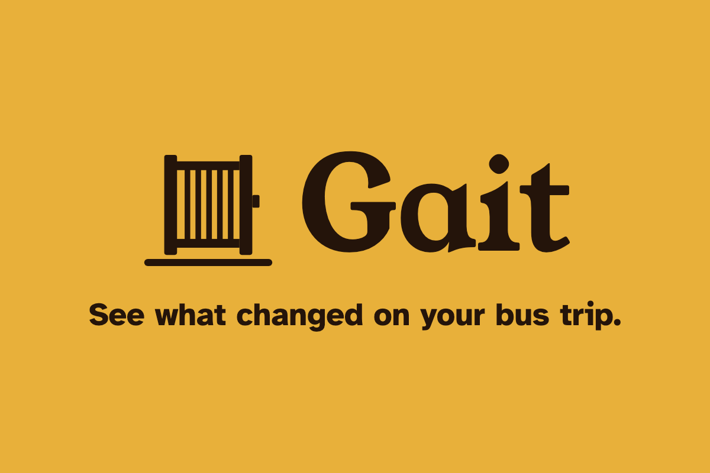

# Gait



**See what changed on your bus trip.** Gait connects City of Toronto council decisions to one resident's own transit trip. Pick a route, your stops and a rider (a wheelchair user, a senior with a walker, or a shift worker), and Gait shows how each decision changes your walk and stops, before and after. It quotes the City's reports with page numbers, and helps you write to your councillor, 311 or the TTC.

Built for FCI CIVIC Hack 2026, Challenge 1: *Making municipal decisions easier to understand.*

## Run it locally

Requires Python 3.11 or newer.

```bash
git clone <this repo> gait && cd gait
python3 -m venv .venv
.venv/bin/pip install -e ".[dev]"
.venv/bin/uvicorn gait.app:app --port 8765
```

Open **http://127.0.0.1:8765**. Use `127.0.0.1` rather than `localhost` if another app already uses port 8765.

Try a real example: **http://127.0.0.1:8765/map?sample=cosburn** (Ontario Line construction moves a 72 Pape stop).

Run the tests:

```bash
.venv/bin/pytest -q
```

All data the app needs is already in `data/`: council items, report quotes, stored AI output, routes, stops, shelters, 311 requests, the sidewalk network, the address index and the City report search index. Nothing needs to be downloaded, and no API key is needed.

**Optional:** the "live research" button on the map calls Claude. To use it, put `ANTHROPIC_API_KEY=...` in a `.env` file in the repo root. It costs about 2 cents per new trip. Everything else works without a key.

## Pages

| URL | What it shows |
|---|---|
| `/` | Landing page |
| `/map` | The main tool: 3D map, before and after, the City's quotes, 311 reports, report writer |
| `/decisions`, `/item/<id>` | Council items: staff recommendation vs decision, comment buttons, checked AI summaries |
| `/access/<place>` | Rider access at a place, with checked AI audit findings |
| `/research/<route>` | Past decisions found in City reports for a route |
| `/route` | The same trip check as plain HTML forms (no JavaScript) |

## How it stays accurate

Everything on screen is one of three things: copied word for word from an official source, computed by fixed rules from open data, or written by AI **and kept only if code finds its quote on the source page**. Numbers must match the source, and the wording can't be stronger than the quote. Gait never guesses a deadline and stores nothing about the user. Simulated changes are labelled on every page.

## Docs

- [`docs/PROJECT_OVERVIEW.md`](docs/PROJECT_OVERVIEW.md): everything in one place
- [`docs/architecture.md`](docs/architecture.md): requirements, architecture, design rationale
- [`docs/ai-use-log.md`](docs/ai-use-log.md): how AI was used and checked
- [`docs/research-notes.md`](docs/research-notes.md): research log and data findings

## Data and licence

City of Toronto Open Data (Open Government Licence – Toronto), TTC GTFS, City of Toronto staff reports. Gait is a prototype, not an official City of Toronto or TTC service.
