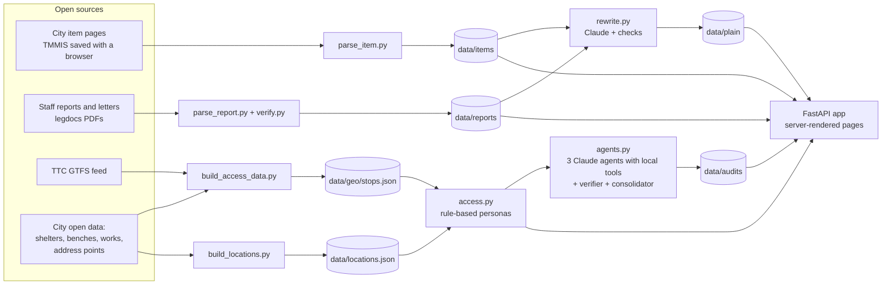

# Gait: requirements, architecture and design rationale

## 1. Requirements (traced to the challenge brief)

| ID | Requirement | Source in brief | Where it is met |
|---|---|---|---|
| R1 | Show what is proposed and why, in plain language | "What success looks like" | `gait/rewrite.py`, item page "In plain language" |
| R2 | Distinguish staff recommendation, committee decision and final Council decision | Constraints | `parse_item.py` stages, item page "Recommended and decided" |
| R3 | Show who and where an item affects | Success criteria | wards from the item page; `access.py` rider view per location |
| R4 | Show key dates and how to have a say, verified on the official item page, never inferred from a meeting date | Constraints | `app.open_window_note`, buttons read from the live page |
| R5 | Every claim links to the exact source passage | Constraints | `verify.py`, `rewrite.check_sentence`, quote toggles |
| R6 | Preserve conditions and uncertainty; a wrong summary is worse than none | Constraints | strong-wording check, long-text warning, "can't tell you" section |
| R7 | Avoid displaying unnecessary personal information from public correspondence | Constraints | `parse_item.py` keeps counts and dates only |
| R8 | Think about who the tool leaves out | Success criteria | riders with different needs; plain language; no JavaScript required; printable |
| R9 | Test on two or three real agenda items | Success criteria | 11 real items, 5 decided/referred and 6 upcoming |
| R10 | Municipal use without the team present | Brief | partly met: needs a Clerk feed (see readiness report) |
| R11 | Make data limitations visible | Datasets | limits section on each page, `docs/research-notes.md` |
| N1 | AI use must be explained and checked | Judging | `docs/ai-use-log.md`, tests in `tests/` |
| N2 | Public, open data only | Rules | all inputs listed in `docs/research-notes.md` and the readiness report |

## 2. Architecture



**Why this shape.** Everything the resident sees is either (a) copied exactly from an official source, (b) computed by fixed rules, or (c) written by AI and then accepted only if software can tie it to an exact source quote. The three kinds are labelled differently on the page. Generation happens offline and results are stored, so the demo is repeatable and a wrong answer cannot appear at presentation time.

## 3. Key design decisions and rationale

1. **No AI where copying works.** Decision wording, recommendations and report summaries are shown verbatim, with page numbers.
2. **AI output is untrusted until checked.** `check_sentence` rejects a rewrite if its quote is not in the source, if it contains a number not in the source, or if it uses stronger wording than the quote ("must", "will", "only"). This stops "Council requested a study" becoming "Council must study".
3. **Agents get tools, not the internet.** Audit agents can only call five local functions bound to one location and rider. Their findings must cite the exact text a tool returned. `verify_findings` rechecks quotes and numbers and bans absolute or alarming words.
4. **Only fixed rules may say "barrier".** Agents may label findings "worth knowing" or "info". This avoids an AI over-alarming on one stop.
5. **A consolidator groups, never writes.** A second model call only returns groups of duplicate findings (validated as a partition). It cannot add text.
6. **Never infer a deadline.** The page lists the buttons the official page shows and links to the live page.
7. **Saved snapshots.** The City site returns HTTP 403 to scripts. For the hackathon, pages were saved with a real browser. A pilot would use a feed from the Clerk.

## 4. Data flow of an item page (sequence)

```mermaid
sequenceDiagram
  participant R as Resident
  participant A as FastAPI app
  participant S as Stored data
  R->>A: GET /item/2026.TE34.104
  A->>S: item JSON, linked report JSON, plain-language rewrites, notes, locations
  A->>A: map status to a fixed plain label; build recommended vs decided; add caveats
  A-->>R: HTML with status, AI-labelled summary, official wording, sources
  R->>A: GET /access/dundas_spadina?persona=wheelchair
  A->>A: rule-based snapshot from stops.json (live, no AI)
  A->>S: stored audit for this place and rider
  A-->>R: flags, stop table, checked agent findings, limits
```

## 5. Verification

| Layer | What is checked | Where |
|---|---|---|
| Parsing | decision text is a verbatim substring of the source; names of letter writers never stored | `tests/test_parse_item.py` |
| Reports | every extracted passage appears in the PDF text | `tests/test_report_and_upcoming.py` |
| AI rewrites | quote in source, numbers match, no stronger wording; stored sentences re-checked | `tests/test_rewrite_checks.py`, `tests/test_plain_store.py` |
| Agents | cited quote in tool result, numbers match, banned words, severity cap, valid grouping | `tests/test_access_agents.py` |
| Humans | manual review of the demo items' rewrites and findings (see AI-use log) | `docs/ai-use-log.md` |

## 6. Limits and what a municipality would add

- Live ingestion needs a feed from the City Clerk.
- Walking distance is straight-line times 1.3. The real sidewalk network, curbs and slopes are not modelled.
- Boarding flags are as published in the TTC schedule file. In that file every streetcar trip is flagged "not accessible", which the file does not explain.
- Shelter and bench data may be incomplete.
- Rider walking limits are illustrative and must be replaced with advice from local accessibility groups.
- No before/after of a proposed network: schedule data for proposals is not published, and Transitland's archive needs a paid or credit-based key.
- Translation and user testing with accessibility groups are not done.


## Map overlays (added Nov 13)

- **Where decisions land** (`app.decision_area`, `GET /api/decision_areas`): built from each change file's effects. Removed, closed or moved stops come from the GTFS stop list (or, for past decisions, the reconstructed stop, skipped where a stop still serves that direction); closed sidewalks come from the pedestrian network edges the closure blocks; `map_line` effects are display-only road closures typed from the report. Places within 450 m share one bubble (convex hull of 70 m circles).
- **New buildings approved** (no longer shown on the map; kept for `/api/developments` and `source_check?bld=`; `scripts/build_developments.py`, `GET /api/developments`, `buildings` in `/api/trip`): from reports in the FTS index that recommend a rezoning "to permit a N-storey" building and whose item status says adopted. The address must match a City address point exactly; meeting-place addresses (City Hall, Metro Hall, civic centres) are skipped. Quotes are whole sentences copied from the page and re-checked; `tests/test_reports.py` verifies them against the index. Gait computes nothing from a building: the panel says so and shows the City's sentences.
- **City works on your route** (`access.works_on_trip`, `works_on_trip` in `/api/trip`): the City road resurfacing and sidewalk construction programs (open data, already in `data/geo`). A listing is kept only if its own street section comes within 20 m of a walk, 30 m of a stop the rider uses, or runs at least 80 m along the ride, and the City's timeline has not ended. Blocks of one job are grouped. The panel shows which part of the trip each one meets, the City's description word for word ("Work may include the closure of individual lanes or the entire road"), and each section as listed; the map draws the exact sections. Nothing is predicted about the closure itself.

### Map results in three pages

There is one panel on `/map`, on the left. After "Show my trip" it switches from setting up the trip to the results ("Edit trip" goes back), which step through four pages with Back and Next: the trip as the rider set it up, what changes for the trip (the verdict and the before and after rows), what the City wrote, and what people report on the new part, with the report writer. On the City page the browser calls `GET /api/source_check?change=<id>`, which re-reads each quote on its cached source page (`source_pages_file`, `source_file`) and returns the page and the text around it. The log the rider sees is the result of that call, not a staged animation; a quote that is not found again is shown as "Not found". With reduced motion every step appears at once.
