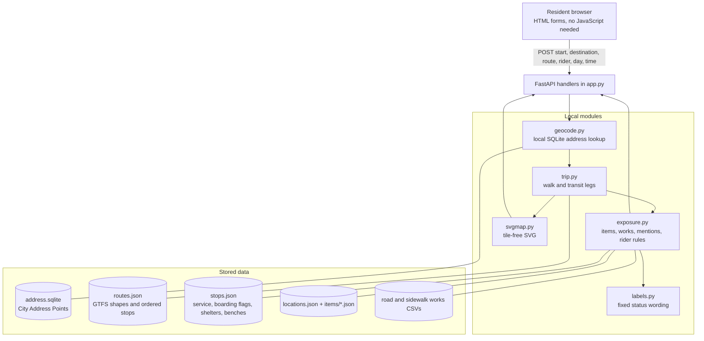
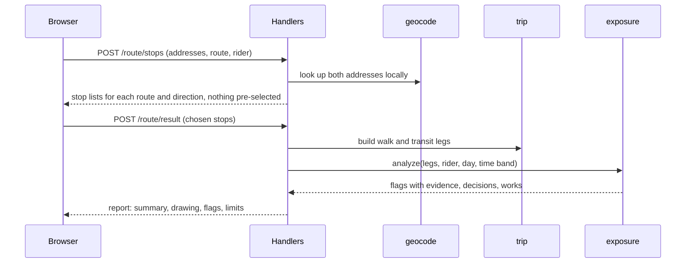

# Route check: architecture (as built)

**Goal.** A resident tells the tool the trip they make: a start address, a destination address, and the bus, streetcar or subway route(s) they take. The tool returns what the open data lists along that trip for their kind of rider: decisions located near it (with status and whether the official page shows comment buttons), planned works along it, how the stops work for them, and whether any decision names their route. Every statement is backed by source text shown on the page.

**Not a goal.** Planning or timing a trip, comparing before and after a change, or recommending a different route. See section 8.

## 1. Requirements

| ID | Requirement | Met by |
|---|---|---|
| F1 | Resident supplies start, destination, route(s), their own boarding and exit stops, rider, day and time of day | `/route` form, `/route/stops`, `/route/result` |
| F2 | The route part of the trip follows the real line the vehicle runs, between the stops the resident picks | `trip.py`, `data/geo/routes.json` (GTFS shapes) |
| F3 | Find council or committee items located near the trip, with status and next action | `exposure.items_near`, `labels.py` |
| F4 | Find planned road and sidewalk works along the trip; say when a listed timeline has ended | `exposure.works_along` |
| F5 | Check boarding flags, route trip flags, shelter and bench listings, and service in the chosen time band for the rider | `exposure.analyze` rules |
| F6 | Say when a decision names the resident's route | `exposure.route_mentions` |
| F7 | Every flag shows the source line it rests on | `flag.evidence` |
| F8 | Works with no JavaScript, with a text version of the drawing | server-rendered pages, SVG with `<title>` and a list |
| N1 | Privacy: store nothing, set no cookies, no address leaves the machine | local address index, tile-free SVG, POST, test `test_route_check_stores_nothing_and_sets_no_cookies` |
| N2 | Honesty: label estimates, never say a trip is possible or safe, only fixed rules say "limit" | limits section, wording rules |

## 2. Components

## 3. Modules

| Module | Responsibility |
|---|---|
| `geocode.py` | Normalizes a typed address (Avenue to Ave, unit prefixes, city names) and looks it up in a local SQLite file built from the City's open Address Points. Returns the place or nearby numbers on the same street. |
| `trip.py` | Loads route lines and ordered stops. `build_transit_leg` cuts the real line between the two stops the resident chose, checking the stop order. `build_trip` adds straight-line walking legs. The tool never picks stops for the resident. |
| `exposure.py` | Distance from the trip to item locations (150 m) and to works (120 m). Finds decisions that name the route. Applies fixed rider rules and orders flags: limits first, then worth knowing (open decisions first), then info. |
| `svgmap.py` | Draws the trip, stops, decisions and works as an inline SVG. No map tiles are requested. |
| `labels.py` | Fixed plain wording for official item statuses. |

## 4. Data model (request scope only)

`Place {label, lat, lon, ward}` · `Leg {kind walk|transit, label, points[], route, board, alight}` · `Flag {severity barrier|watch|info, kind rule|act|item|works|mention, text, evidence[]}`. No user record and no session.

## 5. Request flow

## 6. Rider rules (fixed, in `exposure.analyze`)

- **All riders:** walking legs against the rider's assumed limit (wheelchair 400 m, senior with cane or walker 250 m, shift worker 600 m; straight line times 1.3); departures at the boarding stop in the chosen day and time band (none is a limit); decisions near the trip (open ones marked as ones the resident may still comment on, using the buttons the official page shows); planned works along the trip; decisions that name the route.
- **Wheelchair user:** boarding flag at both stops; the route's trip accessibility flags (in the TTC file every streetcar trip is flagged not accessible).
- **Senior with a cane or walker:** shelter or bench at the boarding stop.

## 7. Privacy and safety design

- Addresses are looked up in a local file. The drawing is generated by the server as SVG. Results come from a POST and the URL contains no address.
- Nothing is written to disk and no cookies are set (tested).
- AI is not used in the route check. Only fixed rules produce flags.
- Wording avoids "safe", "possible" and "accessible route". The page states the walk is an estimate.

## 8. Why there is no routing, timing or alternatives

A router and a published proposed schedule are needed to say how long a trip takes or how a change alters it. Proposed schedules are rarely published, and recommending a different network is a planning decision that should stay with the agency and be presented neutrally. The `trip.py` interface (a list of legs with points) is where a router would plug in.

## 9. Known limits

- Only decisions loaded into the system and given a location can appear (11 items located so far).
- The resident must know their route number. The walk legs are straight lines.
- Only base weekday, Saturday and Sunday schedules are counted. The return trip is not checked.
- Works listings can be out of date. Shelter and bench listings may be incomplete.
- Streetcar trips are all flagged not accessible in the TTC file, which does not explain why.
- Example trips are chosen by the team and reviewed by hand.

## 10. Testing

`tests/test_route_check.py` covers address normalization and suggestions, stop-order errors, the real route line, finding both open decisions on the Queen trip, the "decision names your route" flag for 505 with a check that the quoted snippet is real source text, a far-away trip finding nothing, ended works being downgraded, evidence on every flag, decided items never shown as open, bad input messages, and the privacy test (no files written, no cookies, no address in the URL).
